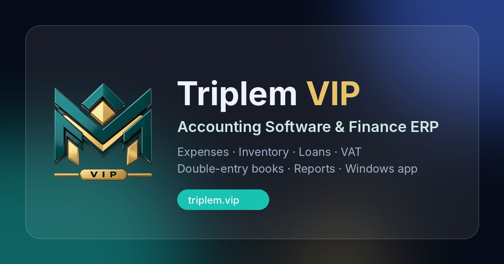

### One private workspace for your money, stock and books

Wallets & expenses · Inventory 2.0 & POS · Loans & installments · Assets · Insurance · Formal Accounting ERP · Triplem AI

 

  

---

## ✨ What is Triplem VIP?

**Triplem VIP** is a private, browser-based finance and accounting workspace for **businesses and individuals**. Owners, finance teams, shops, traders, lenders and insurance agencies use it to keep money, stock, customers and formal books in one secure place, on the web, on the phone and in the official **Windows app**.

Instead of spreadsheets and separate tools, every team member works in the same organised records, and only sees what the account owner allows.

| | |
|:--|:--|
| 🔒 **Private by design** Your own workspace, team permissions, two-factor sign-in and Smart PIN for sensitive actions. | 🌍 **Built for the region and beyond** English, Arabic and Urdu, right-to-left layouts, and six currencies. |
| 📶 **Keeps working offline** Entries made without internet are saved on the device and synced when the connection returns. | 🤖 **Triplem AI** Ask about your own records. Anything the AI prepares stays a draft until you approve it. |

---

## 🧩 Modules

<table>
<tr>
<td width="50%" valign="top">

### 💳 Wallets & expenses
Cash, bank, card and custom wallets, each with its own currency and history. **Expenses**, **Receiving** and **Internal Transfers** are kept apart, so a transfer is never counted as income or expense.

</td>
<td width="50%" valign="top">

### 📦 Inventory 2.0 & point of sale
Products and variants, stock by location, purchases, sales and a fast POS. Barcodes and labels (EAN-13, EAN-8, UPC-A, Code 128), offline sales, customer balances and PDF invoices and receipts.

</td>
</tr>
<tr>
<td valign="top">

### 🤝 Loans & installment plans
Loans given and taken with direction-aware balances. Installment plans **bought** and **sold**, with down payments, advances, schedules, reminders and PDF statements.

</td>
<td valign="top">

### 🏢 Assets & depreciation
The full life of each asset: purchase, maintenance, repairs, running costs, revenue, sale or disposal, and the real profit or loss.

</td>
</tr>
<tr>
<td valign="top">

### 🛡️ Insurance management
Providers and policies, sales and customer documents, commission tracking, cancellations, opening balances and referral settlements.

</td>
<td valign="top">

### 📒 Formal Accounting ERP
Chart of Accounts, journals, sales and purchases, Accounts Receivable and Payable, bank reconciliation, VAT views, Trial Balance, Profit & Loss, Balance Sheet and General Ledger.

</td>
</tr>
<tr>
<td valign="top">

### 📊 Dashboard & Financial Timeline
Live figures and a read-only, chronological view of permitted activity with module, currency and period filters.

</td>
<td valign="top">

### 📝 Notes, reports & exports
Searchable notes and reminders. PDF statements, receipts, invoices and reports, plus CSV and Excel-safe exports.

</td>
</tr>
</table>

---

## 💻 Platforms

| 🌐 Web | 📱 Phone & tablet | 🪟 Windows 10 / 11 |
|:--:|:--:|:--:|
| Works in any modern browser at **[triplem.vip](https://triplem.vip/)** | Installable home-screen app, touch-friendly layouts | Official app on the **[Microsoft Store](https://apps.microsoft.com/detail/9MV028GH5NPX)** with notifications, tray and shortcuts |

---

## 🔐 Security at a glance

- 🔑 Passwords are never visible to anyone, including administrators
- 📲 Optional authenticator-app two-factor sign-in and passkeys
- 🧷 Smart PIN confirmation for sensitive actions
- 🛂 Every permission is checked on the server, not only in the browser
- 👥 Team members see only the modules and actions their owner allows
- 🧾 Exports and backups stay under the account owner's control

More in our **[Security page](https://triplem.vip/Security/)** and **[Privacy policy](https://triplem.vip/seo/privacy-policy.html)**.
Found a security issue? Please see **[security.txt](https://triplem.vip/.well-known/security.txt)**.

---

## 🚀 Get started

1. Open **[triplem.vip](https://triplem.vip/)** or install the app from the **[Microsoft Store](https://apps.microsoft.com/detail/9MV028GH5NPX)**.
2. Choose **Start free trial**: 14 days, full access to the modules you pick, **no card needed**.
3. Add your first wallet, products or customers, or ask us to help you set up.

> When a trial or plan ends, your records are never deleted: you keep read access, search and downloads until a plan is active again. See the **[trial terms](https://triplem.vip/windows-store/trial-terms.html)**.

---

## 💬 Contact & support

| | |
|:--|:--|
| ✉️ **Email** | [info@triplem.vip](mailto:info@triplem.vip) |
| 🎧 **Live Support** | On **[triplem.vip](https://triplem.vip/)** (bottom right) |
| 📘 **Facebook** | [fb.com/triplem.vip](https://fb.com/triplem.vip) |
| 🎵 **TikTok** | [@triplem.vip](https://www.tiktok.com/@triplem.vip) |
| 📚 **Guides** | [triplem.vip/seo](https://triplem.vip/seo/) · [FAQ](https://triplem.vip/seo/faq.html) |

---

## 📁 About this repository

This repository holds the public website and web application front end served at **[triplem.vip](https://triplem.vip/)**. Server-side code, database definitions and credentials are kept private and are never part of this repository.

 
© Triplem VIP. All rights reserved. “Triplem VIP” and the Triplem VIP logo are trademarks of Triplem VIP.
  

